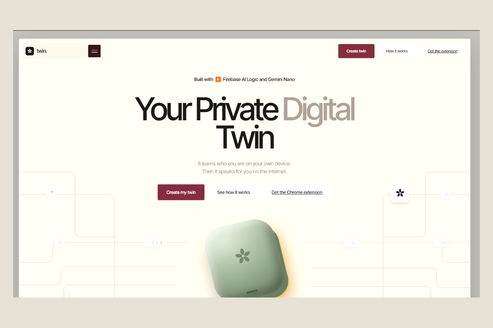
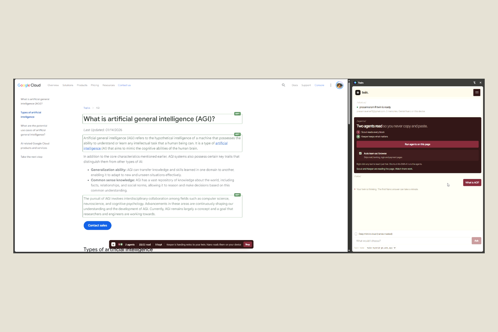
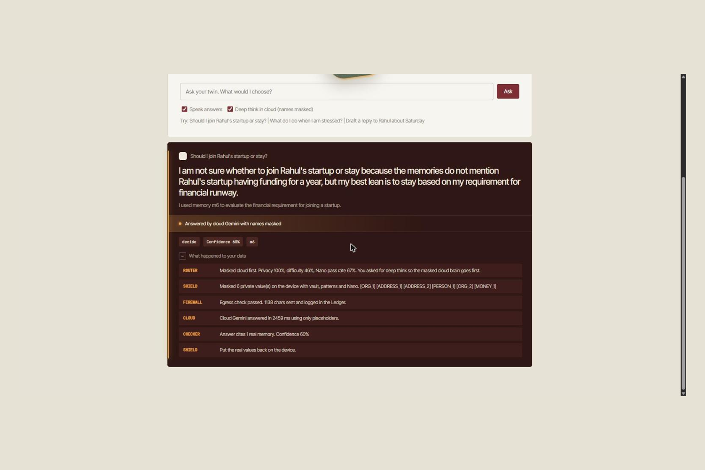
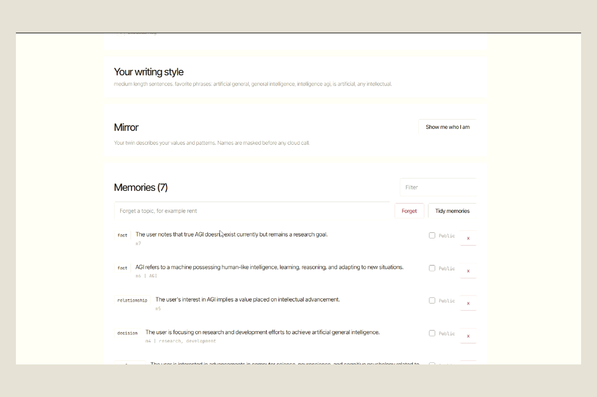
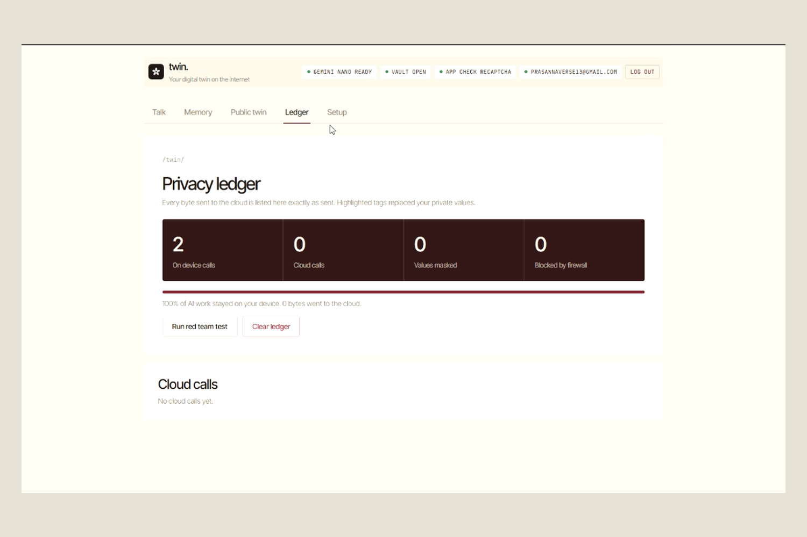
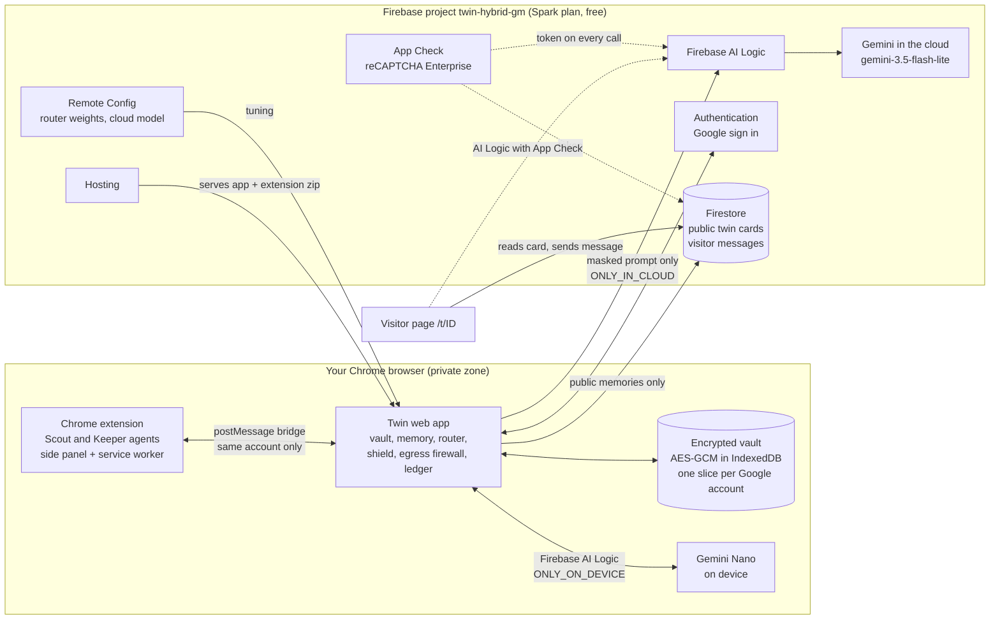
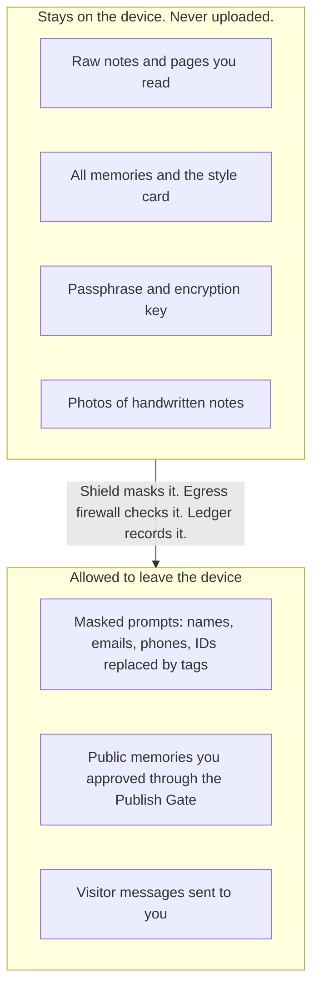
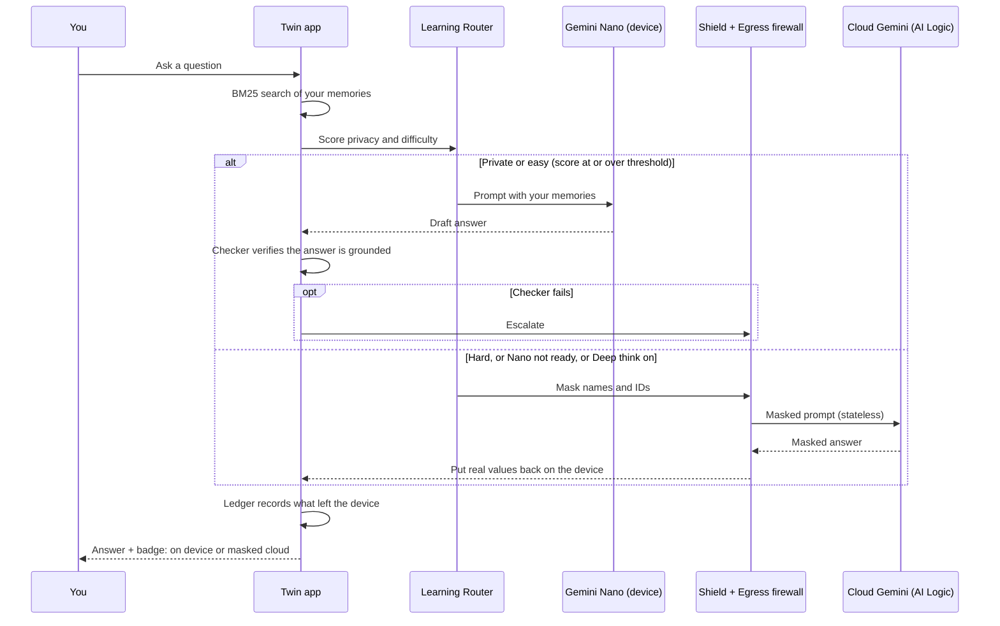
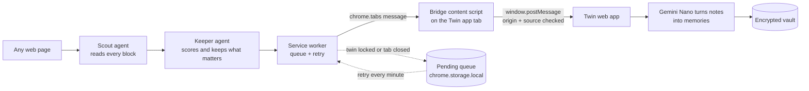

# Twin

**A digital twin that lives on the internet. Private on your device. Public only where you choose.**

Built for the [Firebase #BuildHybridAI 2026](https://firebasehybridaihackathon.devpost.com/) hackathon. Platform: **Web (Chrome)** with a **Chrome extension**. All AI runs through **Firebase AI Logic hybrid inference**: Gemini Nano on the device and Gemini in the cloud.

| | |
|---|---|
| Live app | https://twin-hybrid-gm.web.app |
| Chrome extension | https://twin-hybrid-gm.web.app/twin-extension.zip (also in [`extension/`](extension)) |
| Demo video | Added on the Devpost submission |
| License | [MIT](LICENSE) |

---

## Screenshots

| | |
|---|---|
| <br/>**Landing page.** Sign in with Google to get your own twin. | <br/>**The extension.** Scout reads the page and Keeper marks what to keep. |
| <br/>**Deep think.** Names become tags before anything goes to the cloud. | <br/>**Memories.** Each has a kind, a weight and a source. |
| <br/>**Privacy ledger.** Every byte that left the device, exactly as sent. | |

---

## 1. The idea

Most AI tools make you choose. Keep everything private and get a weak model. Or send everything to the cloud and give up your privacy.

Twin removes the choice. It is a digital twin built from your own notes and the pages you read.

* **Private twin.** Your memories are encrypted on your device. Gemini Nano reads them. Your private questions are answered on the device.
* **Hard questions go to the cloud.** A privacy shield first replaces every name, email, phone and ID with a tag. The cloud model is stateless and never owns your memory. The answer is put back together on your device.
* **Public twin.** You mark some memories public. A Publish Gate blocks anything private. Visitors can talk to your public twin and leave you a message. Your private twin drafts the reply on your device.
* **Chrome extension.** Two agents read the page you are on and save what matters into your twin. You never copy and paste.

This is the point of hybrid inference: **privacy decides where the work runs.**

## 2. Where and how people use it

| Where | What happens |
|---|---|
| **Web app** (https://twin-hybrid-gm.web.app) | Sign in with Google. Create your twin. Add notes or photos of notes. Talk to it by voice or text. Publish a public twin link. |
| **Chrome extension** (side panel) | Browse normally. Two agents read each page, keep the useful parts and teach your twin. Ask your twin questions from any tab. |
| **Public twin link** (`/t/ID`) | Anyone you share the link with can ask your public twin or leave a message. |

## 3. Architecture

### System overview



### Privacy boundary



### One question, step by step



### Extension and agent swarm



The extension never stores your memories. The **web app is the twin storage**. The extension is the hands. It links itself to the one account that is signed in to the web app and refuses to work with any other account.

## 4. How Firebase AI Logic is used

Every model call in the app goes through Firebase AI Logic. There is no direct call to any other model API.

| What | Where | How |
|---|---|---|
| SDK setup | [`src/lib/firebase.ts`](src/lib/firebase.ts) | `getAI(firebaseApp, { backend: new GoogleAIBackend() })` |
| On device model | [`src/lib/firebase.ts`](src/lib/firebase.ts) | `getGenerativeModel(ai, { mode: InferenceMode.ONLY_ON_DEVICE, onDeviceParams })` and `initializeDeviceModel(onProgress)` for the Nano download |
| Cloud model | [`src/lib/firebase.ts`](src/lib/firebase.ts) | `getGenerativeModel(ai, { mode: InferenceMode.ONLY_IN_CLOUD, inCloudParams: { model } })` |
| Per task choice of where to run | [`src/lib/router.ts`](src/lib/router.ts), [`src/lib/cascade.ts`](src/lib/cascade.ts) | The router picks the mode for each task. The SDK reports `inferenceSource`. The app treats an unexpected cloud result for a private task as a privacy fault. |
| Image input on device | [`src/lib/firebase.ts`](src/lib/firebase.ts) | Nano reads a photo of a handwritten note. The image is never uploaded. |
| Structured output | [`src/lib/firebase.ts`](src/lib/firebase.ts) | `responseConstraint` on device and `responseMimeType: application/json` in the cloud |

### Why per task routing and not one mode

The SDK offers `PREFER_ON_DEVICE`, `ONLY_ON_DEVICE`, `PREFER_IN_CLOUD` and `ONLY_IN_CLOUD`. A single fallback mode cannot express a privacy rule. Twin chooses the mode for each task:

```
score = nanoSuccess + privacyWeight x privacy - complexityWeight x complexity
score at or over 0.55  ->  Nano first (ONLY_ON_DEVICE)
score under 0.55       ->  masked cloud first (ONLY_IN_CLOUD)
```

* **privacy** rises with the number of private values in the prompt and with sensitive task types. Private tasks stay on Nano.
* **complexity** rises with task type and prompt length.
* **nanoSuccess** is learned. The router remembers how often Nano passed the checker for each task type (a Beta prior that starts at 50 percent). The more Nano succeeds, the more work stays on the device.
* A **checker** tests every Nano answer. If it fails the answer escalates to the masked cloud path.
* **Deep think** in the UI forces the masked cloud path.

### Other Firebase products

| Product | Use |
|---|---|
| **App Check** | reCAPTCHA Enterprise on the live site. A debug token on localhost. Protects AI Logic and Firestore. |
| **Authentication** | Google sign in gives each person a private twin. Anonymous sign in is used for guests and for visitors of a public twin. |
| **Firestore** | Public twin cards and visitor messages. [Rules](firestore.rules): anyone can read a card, only the owner can write it, only the owner can read messages, field and size checks on every write. |
| **Remote Config** | Router threshold, router weights, token budget and the cloud model name. They change for every user without a new build. See [`remoteconfig.template.json`](remoteconfig.template.json). |
| **Hosting** | Serves the app, the visitor page and the extension zip. |

## 5. Features

1. **Private twin.** Notes become memories on the device. Ask what you would choose. Talk by voice or text and hear the answer.
2. **Hybrid router.** Learning router, checker, escalation and a Deep think switch.
3. **Shield.** Replaces names, emails, phones, addresses and IDs with tags before anything leaves. Puts them back after.
4. **Egress firewall and Ledger.** Blocks a request that still holds a private value. The Ledger shows every byte sent to the cloud exactly as sent.
5. **Red team test.** Runs a fake identity through the shield and shows if anything leaks.
6. **Encrypted vault.** AES-GCM with a key from your passphrase (PBKDF2, 310,000 rounds). Stay unlocked for 8 hours on a device with a key the page cannot read. Lock at any time.
7. **Per account twins.** Each Google account has its own vault slice on the device.
8. **Public twin and Publish Gate.** You approve memories. The gate blocks private values. Visitors talk to the public twin or leave a message.
9. **Photo notes.** Nano reads a handwritten note on the device.
10. **Mirror and Decide mode.** The twin describes your values and blind spots. Ask a should I question and it picks what you would pick.
11. **Backup.** Export your twin as an encrypted file and restore it on another device.
12. **Chrome extension with two agents.** Scout reads every block of a page. Keeper keeps what matters. Auto learn as you browse. Skips mail, banking, login and payment pages. Notes wait in a queue when the twin is locked.

## 6. Hackathon requirements checklist

Checked against the [Overview](https://firebasehybridaihackathon.devpost.com/), [Rules](https://firebasehybridaihackathon.devpost.com/rules), [FAQs](https://firebasehybridaihackathon.devpost.com/details/faqs) and [Resources](https://firebasehybridaihackathon.devpost.com/resources).

| Requirement | Status | Where |
|---|---|---|
| Gen AI app using Firebase AI Logic | Done | [`src/lib/firebase.ts`](src/lib/firebase.ts) |
| Hybrid inference, on device and cloud | Done | Nano via `ONLY_ON_DEVICE`, Gemini via `ONLY_IN_CLOUD`, chosen by the router |
| All inference goes through AI Logic | Done | No other model API is called |
| Platform: Web (Chrome), web app or extension | Done | Both. Web app plus Chrome extension |
| Gemini Nano on Chrome | Done | Chrome Prompt API through the SDK |
| App Check | Done | reCAPTCHA Enterprise live. Debug token on localhost |
| Other Firebase products | Done | Authentication, Firestore, Remote Config, Hosting |
| Public repo with an open source license | Done | [MIT](LICENSE) |
| AI Logic imported and called at runtime | Done | `getAI`, `getGenerativeModel`, `generateContent` in `src/lib/firebase.ts` |
| All source, assets and setup steps in the repo | Done | This README |
| No debug tokens, service keys or `.env` in the repo | Done | `.env` is in `.gitignore`. The values in `webconfig.ts` are public client identifiers |
| Free to use | Done | Spark plan. Free tier models. No sign up fee. No paid APIs |
| Hosted public URL | Done | https://twin-hybrid-gm.web.app |
| Demo video, public on YouTube, 3 minutes or less, English | On the submission form | See [`DEMO.md`](DEMO.md) for the script |
| Text description | Done | [`DEVPOST.md`](DEVPOST.md) |
| New project built in the submission period | Yes | Built for this hackathon |
| AI coding tool disclosure | Disclosed | Built with Claude as a coding assistant. All app AI runs on Firebase AI Logic |

### How it maps to the judging criteria

| Criterion | How Twin answers it |
|---|---|
| **Technological implementation** | Per task hybrid routing with a learned score, a checker with escalation, a privacy shield, an egress firewall and a ledger. Remote Config tunes it live. App Check, Auth and Firestore rules are in place. 17 tests. |
| **Design** | A complete product: landing page, app, extension side panel, public twin page. Clear badges show where each answer ran. |
| **Potential impact** | Anyone who wants AI help without giving up private data: students, professionals, creators who need a public voice that stays safe. |
| **Quality of the idea** | Hybrid inference used as a privacy control and not only as a fallback. The router decides by privacy first. |

## 7. Test it (for judges)

**Fastest path: the live site**

1. Open https://twin-hybrid-gm.web.app in desktop **Chrome 139 or newer**.
2. Click **Continue with Google**, or continue as a guest.
3. Guest option: click **Use demo person**, set the passphrase `demo-pass-2026` and create the twin. These are demo values.
4. Open the Memory tab. Click **Load demo notes** and **Build memories**.
5. Open the Talk tab and ask a private question. The badge says it was answered on the device.
6. Switch on **Deep think in cloud** and ask again. The badge says masked cloud. Open the Ledger tab to see exactly what was sent.
7. Open the Public tab, mark memories public and publish. Open the link in a private window to see the visitor page.

No login or token is needed for the live site. Judges can also read the written description and video without running anything.

**Gemini Nano setup in Chrome**

* Use Chrome 139 or newer on desktop with enough free disk space for the model.
* Enable the Built-in AI flags in `chrome://flags` (for example `prompt-api-for-gemini-nano-multimodal-input` and Gemma 4 for Built-in AI), then restart Chrome.
* Open the Setup tab in the app and press **Download Nano**. You can check with `await LanguageModel.availability()` in DevTools.
* The first Nano answer after a page load can take about a minute. Without Nano the app still works through the masked cloud path.

## 8. Install the Chrome extension

1. Download `twin-extension.zip` from https://twin-hybrid-gm.web.app/twin-extension.zip and unzip it. Or use the [`extension/`](extension) folder from this repo.
2. Open `chrome://extensions`, turn on **Developer mode**, click **Load unpacked** and pick the folder.
3. Open the Twin web app, sign in, unlock your twin and keep the tab open.
4. Click the Twin icon to open the side panel. Open any article and press **Run agents on this page**. Allow page access when Chrome asks.
5. Turn on **Auto learn as I browse** if you want it hands free. Shortcut: `Alt+Shift+K`.

Under Twin home in the panel choose `localhost:5173` for local work or `twin-hybrid-gm.web.app` for the live site.

## 9. Run it yourself

```bash
git clone https://github.com/Prasannaverse13/twin-ready.git
cd twin-ready
npm install
cp .env.example .env        # fill in your own Firebase web config
npm run dev                 # http://localhost:5173
```

**Firebase setup for your own project**

1. Create a Firebase project and add a web app. Turn on **Firebase AI Logic** with the Gemini Developer API.
2. **Authentication**: enable Google and Anonymous.
3. **Firestore**: create a database and publish [`firestore.rules`](firestore.rules).
4. **App Check**: register the web app with reCAPTCHA Enterprise for the live site. For localhost run the app once, copy the debug token from the console and register it under Manage debug tokens. Put it in `VITE_APPCHECK_DEBUG_TOKEN` in your local `.env`. **Never commit it.**
5. **Remote Config**: publish the template in [`remoteconfig.template.json`](remoteconfig.template.json).
6. Put your values in `.env` and in `src/lib/webconfig.ts`.

**Deploy**

```bash
npm run build
firebase deploy --only hosting,firestore:rules,remoteconfig --project YOUR_PROJECT
```

**Tests**

```bash
npm test      # 17 tests
npm run typecheck
```

The tests cover memory extraction, retrieval, grounding, style, consolidation, mode detection, encrypted backup, the red team leak test and the Publish Gate.

## 10. Project layout

```
src/
  app/          main.ts (UI and extension bridge), styles.css
  visitor/      public twin page
  lib/
    firebase.ts   App Check, AI Logic models, Auth, Remote Config
    router.ts     learning router
    cascade.ts    run a task, check it, escalate
    shield.ts     mask and restore private values
    egress.ts     last check before anything leaves
    ledger.ts     record of every cloud send
    memory.ts     extraction, BM25 retrieval, grounding, consolidation
    twin.ts       ask, decide, portrait
    vault.ts      encrypted vault, stay unlocked session
    store.ts      IndexedDB store, one namespace per account
    publish.ts    Publish Gate and Firestore publish
    backup.ts, voice.ts, redteam.ts, config.ts, webconfig.ts
extension/      Manifest V3: side panel, service worker, bridge, swarm
public/         icons, extension zip
tests/          vitest
firestore.rules, remoteconfig.template.json, firebase.json
```

## 11. Security notes

* The values in `src/lib/webconfig.ts` and the reCAPTCHA site key are **public client identifiers** and not secrets. They are protected by App Check, Authentication and the Firestore rules.
* No App Check debug token, service account key or `.env` file is committed.
* The extension only talks to the Twin app origins. The bridge checks the sender window, the origin and a message source field.
* The extension is linked to one account. A different account in the Twin app is refused.
* The saved unlock key is a non extractable `CryptoKey` kept for 8 hours. The Lock button removes it.

## 12. Honest limits

* Nano is small. Extraction quality varies. A grounding check drops memories the notes do not support.
* On device inference needs desktop Chrome with Nano support. On other browsers the app uses the masked cloud path.
* Speech input uses the Chrome speech service. Chrome recognizes on the device when it can. If it cannot, the app tells you.
* The public twin lives in the cloud by design. It only holds what you approved.
* The twin does not sync private memories between devices. This is on purpose. Use the encrypted backup to move it.
* If you lose your passphrase the vault cannot be recovered.

## 13. Links

* Hackathon: https://firebasehybridaihackathon.devpost.com/
* Firebase AI Logic hybrid inference: https://firebase.google.com/docs/ai-logic/hybrid
* Web get started: https://firebase.google.com/docs/ai-logic/hybrid/web/get-started
* Production checklist: https://firebase.google.com/docs/ai-logic/production-checklist
* Chrome hybrid prompting: https://developer.chrome.com/docs/ai/firebase-ai-logic

## License

[MIT](LICENSE)
